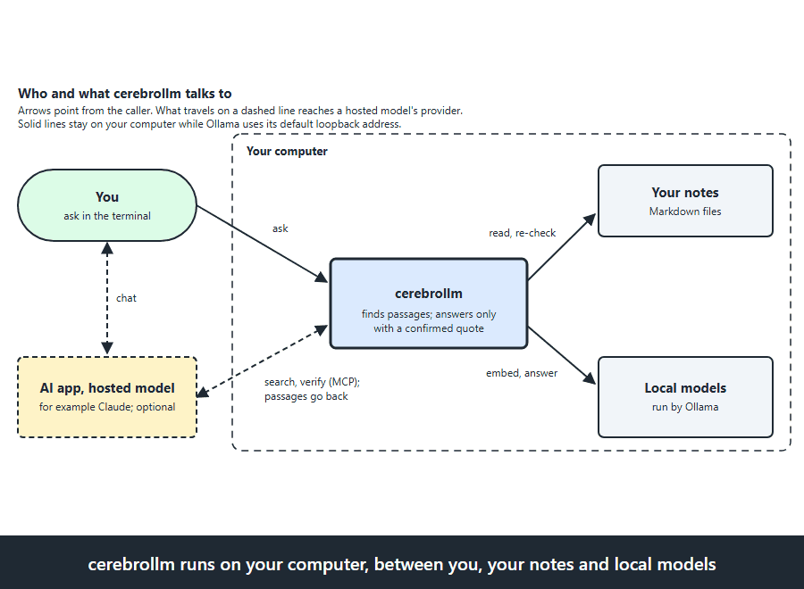
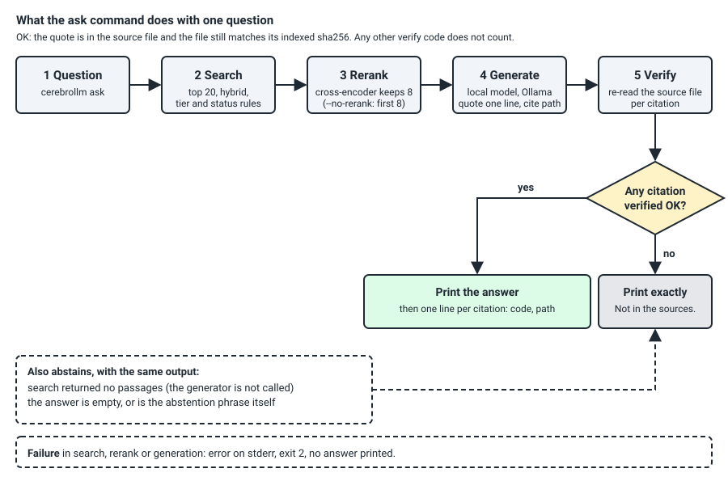

# cerebrollm

Ask a question of your own Markdown documents and get an answer whose quote has been re-read in the source file, or exactly `Not in the sources.`

[](https://github.com/sourav-patra/cerebrollm/actions/workflows/tests.yml)
PyPI: [cerebrollm 0.1.0](https://pypi.org/project/cerebrollm/) · Licence: [MIT](LICENSE) · Python 3.12 · Status: early research

[Quick start](#quick-start) · [How it works](#how-it-works) · [Use it from an AI app (MCP)](#use-it-from-an-ai-app-mcp) · [Results](#results-at-a-glance) · [Documentation](#documentation) · [Product page](https://sourav-patra.github.io/cerebrollm/)



Figure: one question through cerebrollm, built from the three figures below. It leaves out indexing and error exits, which the figures under [How it works](#how-it-works) show.

cerebrollm answers questions from your own Markdown documents, on your own machine. You point it at a folder of notes or specifications. It indexes them in a local PostgreSQL database, finds matching passages (keyword and vector search, then a reranker), asks a local model to quote the line it relies on, and re-reads the source file to confirm the quote. It prints the answer only when the quote is confirmed, and otherwise prints `Not in the sources.` It is for people who run local models, or let a cloud model read their documents through an MCP server, and need every answer traced to a file. Status: 0.1.0, early research; the aim is not yet met by local models.

## The problem it solves

- A language model has not read your notes. It answers from its training data, which never held your specifications or meeting notes.
- A model reads only what fits in its context window (the text it can take in at once, counted in tokens), and every token costs time. A real set of notes does not fit with each question.
- Retrieval (RAG: search the notes first, then hand the model only the matching passages) fixes both, but the model can still ignore or misquote the passages, and the answer still looks sourced. cerebrollm re-reads the cited file before it prints anything.

## Quick start

Tested on Ubuntu 24.04, native or under WSL2 on Windows 11. macOS and native Windows are untested.

| You need | Why | Check |
|---|---|---|
| Python 3.12 | runs cerebrollm | `python3.12 --version` |
| Ollama | runs the embedding model and the answer model locally | `curl http://127.0.0.1:11434/api/version` answers |
| PostgreSQL 16 with pgvector | stores the index; step 2 installs it | `/usr/lib/postgresql/16/bin/postgres --version` prints 16.x |
| About 17 GB of disk | the two Ollama models take about 14.5 GB (`research/model-study/STUDY-DONE.md`), the optional reranker about 2.3 GB | `df -h ~` |
| Measured hardware: a GPU with 12 GB | all speeds and the default answer model `gpt-oss:20b` were measured on one 12 GB card; other hardware, and CPU only, are not measured | `nvidia-smi` |

The commands below are the ones the author ran; the first `index` and `ask` on a fresh machine were not re-run while preparing this release.

1. Clone the repository: `git clone https://github.com/sourav-patra/cerebrollm && cd cerebrollm`. Check: `ls engine/setup` lists `root-ubuntu.sh` and `user.sh`.
2. Install the system packages once, with sudo: `sudo bash engine/setup/root-ubuntu.sh`. Check: `/usr/lib/postgresql/16/bin/postgres --version` prints a 16.x version.
3. Start Ollama, then create the virtual environment and the socket-only PostgreSQL cluster: `bash engine/setup/user.sh`. It is safe to repeat. Check: the last line is `USER SETUP DONE`.
4. Pull the models: `ollama pull qwen3-embedding:0.6b` and `ollama pull gpt-oss:20b`. Check: `ollama list` shows both.
5. Without the clone, `pip install cerebrollm` (or `pip install "cerebrollm[rerank]"` for the reranker) gives the same commands; steps 2, 3 and 4 still apply, and `engine/setup/user.sh` shows the PostgreSQL commands.

### First ask

1. Put your Markdown files in `~/cerebrollm-corpus/notes/`. Check: `ls ~/cerebrollm-corpus/notes` lists them.
2. Copy the configuration and add a rule for that folder. The shipped `engine/cerebrollm.toml` holds example rules and the rules for the public documentation folders the evaluation uses; a file that matches no rule is not indexed, so your folder needs the rule below.

   ```
   cp engine/cerebrollm.toml ~/cerebrollm.toml
   ```

   Append this to `~/cerebrollm.toml`:

   ```
   [[rule]]
   root = "notes"
   glob = "notes/**/*.md"
   tier = "T2"
   status = "current"
   ```

   Then `export CEREBROLLM_CONFIG=~/cerebrollm.toml`. Check: `tail -6 ~/cerebrollm.toml` shows the rule.
3. Build the index: `engine/bin/cerebrollm index`. Check: `engine/bin/cerebrollm status` lists chunks for tier T2.
4. Ask: `engine/bin/cerebrollm ask "a question your notes answer"`. Check: the output is an answer followed by lines such as `OK  notes/guide.md`. A question your notes do not answer prints `Not in the sources.`
5. If the reranker is not downloaded the command stops with an error that names the folder. Download it as described next, or add `--no-rerank`.

After you edit notes, `engine/bin/cerebrollm index --changed` re-indexes only the files that changed.

### The reranker

`ask` and the MCP `rerank` option load `BAAI/bge-reranker-v2-m3` (Apache-2.0) from `~/.cerebrollm/models/bge-reranker-v2-m3`. Nothing is downloaded at query time (`HF_HUB_OFFLINE=1`). Fetch it once, at the pinned revision, and check the hashes:

```
D=~/.cerebrollm/models/bge-reranker-v2-m3; mkdir -p $D && cd $D
R=953dc6f6f85a1b2dbfca4c34a2796e7dde08d41e
for f in config.json sentencepiece.bpe.model special_tokens_map.json tokenizer.json tokenizer_config.json model.safetensors; do
  curl -L -O https://huggingface.co/BAAI/bge-reranker-v2-m3/resolve/$R/$f; done
sha256sum -c <path-to-clone>/eval/runs/retrieval/n7-evidence/bge-reranker-v2-m3.sha256
```

Check: `sha256sum` prints `OK` for six files. The download is about 2.3 GB (`model.safetensors` is 2,271,071,852 bytes in `eval/runs/retrieval/n7-evidence/n7-hf-tree.json`).

## How it works

cerebrollm sits between you, your notes and local models. An AI app can also call it, and that is the one path where passages leave your computer.


Figure: who and what cerebrollm talks to. Arrows point from the caller. What travels on a dashed line reaches a hosted model's provider. Solid lines stay on your computer only while Ollama uses its default loopback address (`base_url` in `cerebrollm.toml`), which cerebrollm does not enforce. It leaves out the AI app's own traffic to its provider, which cerebrollm does not see.

Inside, one program does the work. It keeps an index of passages in PostgreSQL, calls Ollama for embeddings and answers, and loads a reranker from local files.


Figure: the parts of cerebrollm and what each link does, read against `engine/cerebrollm/`. It shows the default configuration with Ollama on loopback, and leaves out the configuration file and the secret scan that runs while indexing.

### What `cerebrollm ask` does



Figure: the five steps of `ask` and its output gate, read against `engine/cerebrollm/answer.py` (function `ask`, gate `decide`). It leaves out indexing, the MCP server and the other commands.

1. Search takes the top 20 passages with the default hybrid search (`cerebrollm search`), which applies the status filter and the tier and recency boosts from `cerebrollm.toml`.
2. Rerank scores those 20 with the cross-encoder `BAAI/bge-reranker-v2-m3` and keeps 8. `--no-rerank` keeps the first 8 of the search instead.
3. Generate sends the 8 passages, marked as data, to a local Ollama model (default `gpt-oss:20b`, only models listed as allowed in `engine/models.toml`) and asks for one quoted line with its path.
4. Verify re-reads each cited file and checks that the quote is in it and that the file still has the sha256 recorded at indexing time.
5. The gate prints the answer when at least one citation verified `OK`, and prints exactly `Not in the sources.` in every other case, including an empty answer and no search hits. A failure in search, rerank or generation prints an error on stderr and exits 2; it never prints an answer.

Other commands: `index`, `search`, `verify`, `status` and `mcp` (a read-only MCP server with the tools `search` and `verify`). `engine/README.md` documents each one.

## Use it from an AI app (MCP)

Install the package into the cerebrollm environment first: `~/.cerebrollm/venv/bin/pip install "cerebrollm[rerank]"`. Check: `~/.cerebrollm/venv/bin/cerebrollm --help` lists the commands. From a clone without the package, use the absolute path of `engine/bin/cerebrollm` as the command instead.

Register `cerebrollm mcp` as a stdio server in your MCP host. It offers two read-only tools, `search` and `verify`, and returns passages inside `<<<BEGIN RETRIEVED DATA>>>` markers so that a host can treat them as data. A host that sends tool results to a cloud model sends your passages to that provider. Nothing else leaves the machine except what you set up yourself (the Ollama address in `cerebrollm.toml` defaults to loopback and is not restricted to it).

Hosts that read a JSON server list take this entry; replace `<you>` with your user name:

```
{"mcpServers": {"cerebrollm": {
  "command": "/home/<you>/.cerebrollm/venv/bin/cerebrollm",
  "args": ["--config", "/home/<you>/cerebrollm.toml", "mcp"]}}}
```

Claude Code, on the same Linux machine: `claude mcp add --scope user cerebrollm -- ~/.cerebrollm/venv/bin/cerebrollm --config ~/cerebrollm.toml mcp`. Claude Code on Windows with cerebrollm under WSL2: `claude mcp add --scope user cerebrollm -- wsl.exe -d Ubuntu-24.04 -e /home/<you>/.cerebrollm/venv/bin/cerebrollm --config /home/<you>/cerebrollm.toml mcp`. Check: `claude mcp list` shows `cerebrollm` as connected.

## Results at a glance

Measured on one machine (Windows 11, WSL2 Ubuntu 24.04, RTX 4070 SUPER with 12 GB) with public documentation as the corpus. The full tables, the v2 evaluation method and every limit are in [docs/RESULTS.md](docs/RESULTS.md).

| Question | Result | Source | State |
|---|---|---|---|
| Does retrieval help a small local model? `phi4`, 60 questions | without retrieval 1/60, with retrieval 47/60 | `eval/RESULTS.md` | measured |
| How often is `gpt-oss:20b` confidently wrong on 35 questions about recent releases? | no retrieval 122 of 175 runs, plain search 17 of 175, `cerebrollm ask` 7 of 104 | `eval/RESULTS-v2.md` | measured |
| Does `ask` meet the aim of at least 90% right outcomes with under 2% confidently wrong runs? | not met by any local model; met only by Claude Sonnet 5.5 with plain search | `eval/RESULTS-v2.md` | measured |
| Does the top 8 hold a line that answers the question? 60 questions | default search 45/60, with the reranker 46/60 | `eval/runs/retrieval/R-summary.md` | measured |

`ask` trades answers for safety: it removes most confidently wrong runs and says `Not in the sources.` more often, including on some questions the notes answer. Only Markdown files are indexed. The gate checks that a quote exists in the file, not that it answers the question.

## Documentation

| To | Read |
|---|---|
| see every measured number, the evaluation method and all limits | [docs/RESULTS.md](docs/RESULTS.md) |
| fix an install or indexing error | [docs/TROUBLESHOOTING.md](docs/TROUBLESHOOTING.md) |
| use each command and its options | [engine/README.md](engine/README.md) |
| find a file, or learn what was withheld from this repository | [docs/REPOSITORY.md](docs/REPOSITORY.md) |
| read the locked design: [PRD](docs/design/PRD-cerebrollm-2026-10-30.md), [TRD](docs/design/TRD-cerebrollm-2026-10-30.md), [LLD](docs/design/LLD-cerebrollm-2026-10-30.md), [POLICY](docs/design/POLICY-cerebrollm-2026-10-30.md) | `docs/LOCKS.md` holds the hash of each (locked 2026-10-30); `SECURITY.md`, `CONTRIBUTING.md`, `docs/DATA.md`, `docs/RELEASING.md` and `docs/GOVERNANCE.md` come from the POLICY |
| know what data leaves the machine and how releases work | [docs/DATA.md](docs/DATA.md), [docs/RELEASING.md](docs/RELEASING.md), [docs/GOVERNANCE.md](docs/GOVERNANCE.md) |
| contribute or report a vulnerability | [CONTRIBUTING.md](CONTRIBUTING.md), [SECURITY.md](SECURITY.md) (not a public issue) |
| see what changed | [CHANGELOG.md](CHANGELOG.md) |

## Licence

Code: MIT ([LICENSE](LICENSE)). Third-party text copied into `eval/` and `research/` is credited in `NOTICE`. Documents follow `DOC-PHILOSOPHY.md`.

Skipped or not checked: the first `index` and `ask` on a fresh machine, the reranker download, the Qwen3.6 context ladder, GLM-4.7-Flash (pulled, not measured), and the figures on the PyPI page, which does not resolve the relative image paths.
