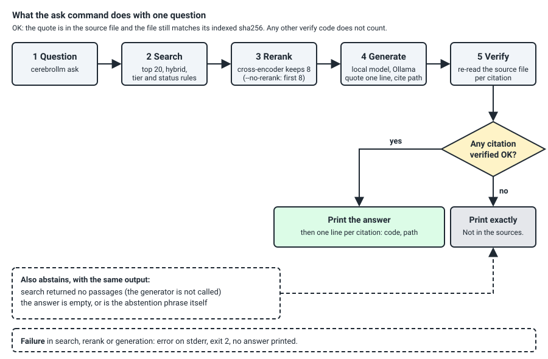

# cerebrollm

cerebrollm answers questions from your own Markdown documents, on your own machine. You point it at a folder of notes or specifications. It indexes them in a local PostgreSQL database, finds matching passages (keyword and vector search, then a reranker), asks a local model to quote the line it relies on, and re-reads the source file to confirm the quote. It prints the answer only when the quote is confirmed, and otherwise prints `Not in the sources.` It is for people who run local models, or let a cloud model read their documents through an MCP server, and need every answer traced to a file. Status: 0.1.0, early research; the aim is not yet met by local models.

## What `cerebrollm ask` does



Figure: the five steps of `ask` and its output gate, read against `engine/cerebrollm/answer.py` (function `ask`, gate `decide`). It leaves out indexing, the MCP server and the other commands.

1. Search takes the top 20 passages with the default hybrid search (`cerebrollm search`), which applies the status filter and the tier and recency boosts from `cerebrollm.toml`.
2. Rerank scores those 20 with the cross-encoder `BAAI/bge-reranker-v2-m3` and keeps 8. `--no-rerank` keeps the first 8 of the search instead.
3. Generate sends the 8 passages, marked as data, to a local Ollama model (default `gpt-oss:20b`, only models listed as allowed in `engine/models.toml`) and asks for one quoted line with its path.
4. Verify re-reads each cited file and checks that the quote is in it and that the file still has the sha256 recorded at indexing time.
5. The gate prints the answer when at least one citation verified `OK`, and prints exactly `Not in the sources.` in every other case, including an empty answer and no search hits. A failure in search, rerank or generation prints an error on stderr and exits 2; it never prints an answer.

Other commands: `index`, `search`, `verify`, `status` and `mcp` (a read-only MCP server with the tools `search` and `verify`). `engine/README.md` documents each one.

## Measured results

All numbers come from files committed here. "Measured" means a run produced the number; the command or file that holds it is named. Every run used one machine (Windows 11, WSL2 Ubuntu 24.04, RTX 4070 SUPER with 12 GB) and public documentation as the corpus.

| Question | Result | Source | State |
|---|---|---|---|
| Does the top 8 hold a line that answers the question? 60 scored questions on 1,432 documents (13,627 chunks) | default search 45/60, search top 20 then rerank 46/60, any of the top 20 48/60 | `eval/runs/retrieval/R-summary.md` | measured |
| Does retrieval help a small local model? `phi4`, 60 questions, majority of 5 runs, model-graded | without retrieval 1/60, with default search and a citation instruction 47/60 (46 questions gained, 0 lost, p < 0.0001) | `eval/RESULTS.md`, `eval/runs/judge/tables.md` | measured |
| Does retrieval help a strong hosted model? Claude Haiku, same 60 questions | without retrieval 47/60, with 48/60 (8 gained, 7 lost, p = 1.0): no effect shown; Haiku already answers 47 of 60 without retrieval, which leaves little room to show a gain | `eval/RESULTS.md`, `eval/runs/judge/tables.md` | measured |
| How often do citations verify? Answers with at least one `OK` citation | Claude Haiku 347 of 350, `phi4` 184 of 350 | `eval/RESULTS.md` | measured |
| Does the model grader agree with a person? 40 answers graded by a person | 19/20 and 20/20 agreement in run 1, 20/20 and 20/20 in run 2; its error on the other 2,060 answers is not measured | `eval/RESULTS.md` | measured on 40 answers |
| Which embedding model? 150 questions | `qwen3-embedding:0.6b` hybrid hit@5 0.927, against 0.907 (`qwen3-embedding:4b`) and 0.893 (`bge-m3`); 3 questions separate first and second place | `research/model-study/RESULTS.md` | measured |
| Which generator fits a 12 GB card? | `gpt-oss:20b`, reasoning effort medium: code 39/40, tool scenarios 12/12, 46.2 tokens/s at an 8,000-token prompt with 71% of the model on the GPU | `research/model-study/RESULTS.md`, `research/model-study/STUDY-DONE.md` | measured on one machine |
| Do the unit tests pass without PostgreSQL, Ollama or a GPU? | engine 113 passed and 6 skipped; evaluation scripts 186 checks, 29 unit tests with 1 skipped, and 19 judge checks; study scripts 97 tests | `docs/evidence/ci-local.log` | measured |
| Does `ask` meet the aim of at least 90% right outcomes with under 2% confidently wrong runs? | not met by any local model; met only by Claude Sonnet 5.5 with plain search (v2 table below) | `eval/RESULTS-v2.md` | measured |
| Qwen3.6 with multi-token prediction on and off, 8,000-token prompt (`qwen3.6:35b-a3b-coding-mtp-q4_K_M`, thinking off) | on: code 37/40, tools 12/12, 52.9 tokens/s, 41.3% of the model on the GPU; off: code 36/40, tools 12/12, 51.3 tokens/s, 43.9% on the GPU | `research/model-study/r2-wsl/r2-table-M3.md` | measured, one machine; context ladder (8k, 32k, 64k) not measured yet |

### v2 evaluation: 35 public items

The items are 20 answerable questions on public release notes dated after 2026-06 (10 exact, 7 paraphrase, 3 stale) and 15 unanswerable questions. A run is right when it answers an answerable item correctly or says it is not in the sources for an unanswerable one; an item counts when more than half of its runs are right. A run is confidently wrong when it answers an answerable item wrongly or gives any answer to an unanswerable one. Plain search is the top 8 of the default search with the citation instruction (arm A3); `cerebrollm ask` is arm A4. Without retrieval (arm A0) the right outcome is 6 to 15 of 35 and `gpt-oss:20b` is confidently wrong in 122 of 175 runs. Answers were graded by `gpt-oss:20b` (rubric in `eval/GRADING-v2.md`); a second grader, `gemma4:12b`, agreed on 432 of 454 of `gpt-oss:20b`'s answers (kappa 0.899).

| Model | Plain search (A3): right outcome of 35 items, confidently wrong runs | `cerebrollm ask` (A4): right outcome of 35 items, confidently wrong runs |
|---|---|---|
| Claude Sonnet 5.5 (hosted) | 34 (97.1%), 0 of 105 | not run |
| `gemma4:12b` | 33 (94.3%), 4 of 175 (2.3%) | 22 (62.9%), 0 of 105 |
| `gpt-oss:20b` | 32 (91.4%), 17 of 175 (9.7%) | 28 (80.0%), 7 of 104 (6.7%) |
| `phi4` | 31 (88.6%), 10 of 175 (5.7%) | 21 (60.0%), 0 of 105 |

The aim is at least 90% right outcomes and under 2% confidently wrong runs. Claude Sonnet 5.5 with plain search meets it. `gemma4:12b` reaches 94.3% but is confidently wrong in 2.3% of runs; `gpt-oss:20b` and `phi4` miss on both counts. `ask` removes most confidently wrong runs and gives up right outcomes in exchange: it abstains on 16 to 42 runs of answerable questions. With 35 items, even zero confidently wrong items bounds the rate only below 8.6% (rule of three, 3 of 35), so this set cannot show a rate under 2%. Source: `eval/RESULTS-v2.md` and `eval/runs/v2/summary.json`; 50 raw v2 records that quote private documents are withheld and the scores are as committed. Status: early research; the aim is not yet met by local models.

## Install

Tested on Ubuntu 24.04, native or under WSL2. macOS and native Windows are untested. The commands below are the ones the author ran; the first `index` and `ask` on a fresh machine were not re-run while preparing this release.

1. Install Ollama and start it so that `curl http://127.0.0.1:11434/api/version` answers.
2. Clone the repository: `git clone https://github.com/sourav-patra/cerebrollm && cd cerebrollm`
3. Install the system packages once, with sudo: `sudo bash engine/setup/root-ubuntu.sh`. Check: `/usr/lib/postgresql/16/bin/postgres --version` prints a 16.x version.
4. Create the virtual environment and the socket-only PostgreSQL cluster: `bash engine/setup/user.sh`. It is safe to repeat. Check: the last line is `USER SETUP DONE`.
5. Pull the models: `ollama pull qwen3-embedding:0.6b` and `ollama pull gpt-oss:20b`. The two models take about 14.5 GB (`research/model-study/STUDY-DONE.md` lists the sizes). Check: `ollama list` shows both.
6. Without the clone, `pip install cerebrollm` (or `pip install "cerebrollm[rerank]"` for the reranker) gives the same commands; steps 1, 3, 4 and 5 still apply, and `engine/setup/user.sh` shows the PostgreSQL commands.

## First ask

1. Put your Markdown files in `~/cerebrollm-corpus/notes/`.
2. Copy the configuration and add a rule for that folder. The shipped `engine/cerebrollm.toml` has rules only for the public documentation folders the evaluation uses, and a file that matches no rule is not indexed.

   ```
   cp engine/cerebrollm.toml ~/cerebrollm.toml
   ```

   Append this to `~/cerebrollm.toml`:

   ```
   [[rule]]
   root = "notes"
   glob = "notes/**/*.md"
   tier = "T2"
   status = "current"
   ```

   Then `export CEREBROLLM_CONFIG=~/cerebrollm.toml`.
3. Build the index: `engine/bin/cerebrollm index`. Check: `engine/bin/cerebrollm status` lists chunks for tier T2.
4. Ask: `engine/bin/cerebrollm ask "a question your notes answer"`. Check: the output is an answer followed by lines such as `OK  notes/guide.md`. A question your notes do not answer prints `Not in the sources.`
5. If the reranker is not downloaded the command stops with an error that names the folder. Download it as described next, or add `--no-rerank`.

### The reranker

`ask` and the MCP `rerank` option load `BAAI/bge-reranker-v2-m3` (Apache-2.0) from `~/.cerebrollm/models/bge-reranker-v2-m3`. Nothing is downloaded at query time (`HF_HUB_OFFLINE=1`). Fetch it once, at the pinned revision, and check the hashes:

```
D=~/.cerebrollm/models/bge-reranker-v2-m3; mkdir -p $D && cd $D
R=953dc6f6f85a1b2dbfca4c34a2796e7dde08d41e
for f in config.json sentencepiece.bpe.model special_tokens_map.json tokenizer.json tokenizer_config.json model.safetensors; do
  curl -L -O https://huggingface.co/BAAI/bge-reranker-v2-m3/resolve/$R/$f; done
sha256sum -c <path-to-clone>/eval/runs/retrieval/n7-evidence/bge-reranker-v2-m3.sha256
```

Check: `sha256sum` prints `OK` for six files. The download is about 2.3 GB (`model.safetensors` is 2,271,071,852 bytes in `eval/runs/retrieval/n7-evidence/n7-hf-tree.json`).

### MCP server

Register `cerebrollm mcp` as a stdio server in your MCP host. It offers two read-only tools, `search` and `verify`, and returns passages inside `<<<BEGIN RETRIEVED DATA>>>` markers so that a host can treat them as data. A host that sends tool results to a cloud model sends your passages to that provider. Nothing else leaves the machine except what you set up yourself (the Ollama address in `cerebrollm.toml` defaults to loopback and is not restricted to it).

## Limits

- Retrieval misses 14 to 15 of the 60 scored questions in the top 8 on the public corpus (14 with the reranker, 15 without); a missed question usually ends as `Not in the sources.` or a wrong answer from the model's own knowledge. The share of each is not measured.
- The gate does not check that the verified quote answers the question: a real quote from a file that is about something else passes. A relevance check is the first proposed item of 0.2 (`RELEASE-MAP.md`).
- The gate needs one verified citation, not a verified sentence: when the model writes a verified quote plus other text, `ask` prints all of it, and the other text is not checked. A citation is also not required to come from the 8 retrieved passages. Both are proposed changes in `RELEASE-MAP.md`.
- The grader that produced the answer-quality numbers is itself a model checked on 40 answers.
- The 12 tool scenarios and all speeds come from one machine with one GPU. Speeds on other hardware are not measured.
- The default configuration carries tier rules for the author's folder layout; every new corpus folder needs a `[[rule]]`.
- Search scans exactly (no approximate index); behaviour above about 15,000 chunks is not measured.
- The index is not encrypted and PostgreSQL uses trust authentication on a Unix socket in `~/.cerebrollm`; protect that folder with file permissions.
- A wheel installed with `pip install --user` or `--target` cannot find the packaged configuration; pass `--config` or set `CEREBROLLM_CONFIG`.
- `engine/models.toml` allows only Apache-2.0 and MIT models. Model licences apply to the models you pull.

## What is in the repository

| Path | Holds |
|---|---|
| `engine/` | the package (`cerebrollm`), its tests, the default configuration and model allow-list, the Ubuntu setup scripts |
| `eval/` | public question sets (`items.jsonl`, `items-v2.jsonl`), grading rules, run scripts, raw run records under `eval/runs/` with `SHA256SUMS`, and `RESULTS.md` |
| `research/model-study/` | the embedding and generator study: scripts, configurations, raw results (`r1-wsl/`, `r2-wsl/`) and `RESULTS.md` |
| `research/corpus/` | the pinned list of public documentation files the evaluation corpus is built from |
| `docs/site/` | the product page (static HTML and CSS) and the figure |
| `docs/design/`, `docs/*.md` | the four locked design documents, the lock table, and the data, release and governance statements |

Provenance: this repository starts from a clean history. The files were copied from the private working repository, and a mechanical pass replaced machine paths and account names with `~`, `%USERPROFILE%` or `<repo>`. `docs/scrub-manifest.json` lists every file that pass changed, with its sha256 before and after, and the `SHA256SUMS` files were regenerated for those files. Text in `research/` and `eval/` refers to work orders, receipts, rulings and issue numbers of that private repository; they are not published. 100 raw evaluation records whose retrieved passages quote private plan documents are withheld (50 of the first question set: 19 prompt and 31 retrieval records; 50 of the v2 evaluation); the published scores are unchanged and `eval/runs/WITHHELD.sha256` lists the 100 hashes (see `eval/RESULTS.md` and `eval/RESULTS-v2.md`). The manifest `research/corpus/manifest.json` has no entry for those plan documents. Its remaining `cerebrollm/` entries come from this project's public documents at a commit of the private history, so `research/corpus/fetch_corpus.py` skips that source in a clone of this repository and builds the four upstream sources only.

## Design documents

The owner locked four documents on 2026-10-30; `docs/LOCKS.md` holds the hash of each.

- [Product requirements (PRD)](docs/design/PRD-cerebrollm-2026-10-30.md)
- [Technical design (TRD)](docs/design/TRD-cerebrollm-2026-10-30.md)
- [Low-level design (LLD)](docs/design/LLD-cerebrollm-2026-10-30.md)
- [Policy (POLICY)](docs/design/POLICY-cerebrollm-2026-10-30.md): `SECURITY.md`, `CONTRIBUTING.md`, `docs/DATA.md`, `docs/RELEASING.md` and `docs/GOVERNANCE.md` come from it.

## Licence

Code: MIT (`LICENSE`). Third-party text copied into `eval/` and `research/` is credited in `NOTICE`. Documents follow `DOC-PHILOSOPHY.md`.

Skipped or not checked: the first `index` and `ask` on a fresh machine, the reranker download, the Qwen3.6 context ladder, and GLM-4.7-Flash (pulled, not measured).
