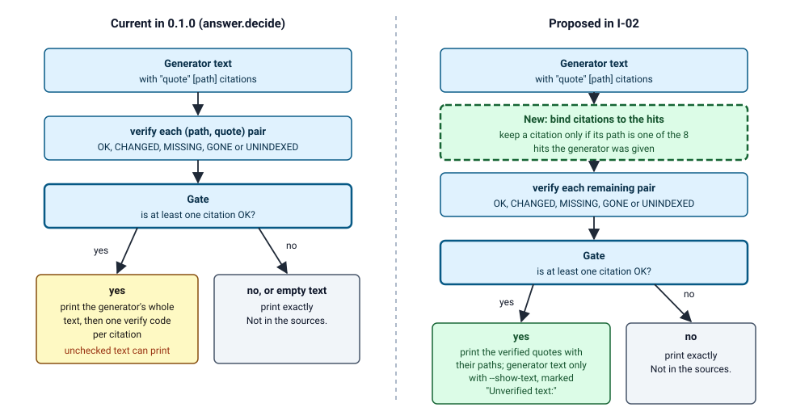

Read section 4 to pick the next issue to build, section 2 to find the file and test behind any function, and section 5 for the order.

# cerebrollm LLD: modules as built and the 0.2 issues

## 1. Scope and marks

This LLD lists what exists in 0.1.0 (files, functions, tests) and turns the TRD's known limits and the PRD's proposed requirements into issues with an acceptance check each. Packaging, CI, README and the leak scan belong to the release work item, not to this LLD.

Marks: E observed in code in this pass; R reported by a committed log or result file; P proposed; N not measured, with the command that would measure it.

## 2. Engine modules, `engine/cerebrollm/`

Test counts come from `grep -c "def test_" engine/tests/test_*.py` (E: 119 in total). Their pass result is R: `119 passed, 61 subtests passed` on 2026-10-29 (`eval/runs/retrieval/n7-evidence/engine-suite.log`); not re-run in this pass.

| Module | Key functions and classes | Tests |
|---|---|---|
| `__init__.py` | sets default environment values `ANONYMIZED_TELEMETRY=False`, `HF_HUB_OFFLINE=1`, `TRANSFORMERS_OFFLINE=1`, `DO_NOT_TRACK=1`, `OLLAMA_HOST` (loopback) before any library import | none |
| `__main__.py`, `cli.py` | `main(argv)`: six subcommands, exit 2 on an `ask` failure, 1 on a non-OK `verify` | `test_answer.py` CLI tests |
| `config.py` | `Config` (derived table names, state paths, connection URLs), `expand_paths`, `load` | `test_config.py` (2) |
| `rules.py` | `never_reason`, `classify`, `secret_hit` (9 patterns), `family`, `apply_supersession`, `status_line_superseded`, `collapse_duplicates`, `full_match` | `test_rules.py` (20) |
| `corpus.py` | `read_source` (real-path containment, or `git show`), `enumerate_corpus`, `doc_id` | `test_corpus.py` (4), `test_end_to_end.py` (1) |
| `glue.py` | `SourceDoc` (hash ignores mtime), `MergeSmall`, `TableRows`, `LocateChunks`, `headings`, `heading_path`, `table_pieces` | `test_chunking.py` (12) |
| `indexer.py` | `make_documents`, `chunk_steps`, `build_pipeline`, `run_index` (full rebuild then swap, or `--changed`), `drop_command` | `test_swap.py` (9), `test_end_to_end.py` |
| `store.py` | `vector_store`, `embed_model` (query prefix, `num_ctx`), `sql`, `swap_in`, `row_count`, `drop_table`, `model_digest`, `read_state`, `write_state` | `test_swap.py` |
| `search.py` | `run_search`, `rrf_fuse`, `recency_multiplier`, `distinct_by_text`, `expand_query`, `sanitize`, `cap_text`, `format_hits`, `to_json` | `test_search.py` (18) |
| `rerank.py` | `settings`, `_load` (local folder, CUDA if visible), `score`, `rerank`, `release` | `test_answer.py` rerank tests |
| `answer.py` | `build_prompt`, `extract_citations`, `check_citations`, `decide`, `chat_model`, `ollama_generate`, `ask`, `format_result`, `to_json` | `test_answer.py` (27) |
| `verify.py` | `run_verify` (`OK`, `CHANGED`, `MISSING`, `GONE`, `UNINDEXED`), `_resolve`, `_indexed_sha` | `test_verify.py` (7) |
| `status.py` | `collect`, `format_status` | `test_end_to_end.py` |
| `mcp_server.py` | `search_tool`, `verify_tool`, `_search_page`, `_neutral`, `_guard`, `_down_message`, `run` | `test_mcp_server.py` (19) |

Support files: `engine/cerebrollm.toml`, `engine/models.toml`, `engine/requirements.txt` (pinned versions, no hashes), `engine/setup/root-ubuntu.sh` and `user.sh` (PostgreSQL 16 cluster on a Unix socket, Python environment), `engine/bin/cerebrollm`.

## 3. Evaluation and study code

| File | Does | Check |
|---|---|---|
| `eval/items.jsonl`, `eval/GRADING.md`, `eval/grade_lib.py`, `eval/check_items.py` | 70 frozen v1 items and the keyword grader | `eval/test_grade.py` |
| `eval/judge.py`, `eval/judge_v2.py` | model grader, one call per answer, rubric for unanswerable items | `eval/test_judge.py` |
| `eval/items-v2.jsonl`, `eval/GRADING-v2.md`, `eval/check_items_v2.py`, `eval/verify_v2_sources.py` | 35 public v2 items (20 answerable, of kinds exact, paraphrase and stale, and 15 unanswerable) and their source checks | `eval/test_check_items_v2.py` (25) |
| `eval/run_v2.py`, `eval/report_v2.py` | generate arms A0, A3, A4, grade, classify, report | `eval/test_run_v2.py` (4) |
| `eval/analyze.py`, `eval/n2_lib.py`, `eval/prepare.py`, `eval/owner_sheets.py` | v1 comparison, tables, prompts, blind owner sheets | none |
| `eval/runs/retrieval/measure_rerank.py` | top-8 hit rate with and without rerank | output in `R-summary.json` |
| `research/model-study/model_guard.py` | guarded pull and unload, disk floor, licence and digest checks | `test_model_guard.py` (67) |

## 4. 0.2 issues (proposed)

Each issue is one pull request with its test. Sizes are estimates, not measured.

### I-01 `verify` answers the same for an excluded file as for an absent quote
- Source: TRD K-2, PRD RQ-19.
- Change: in `verify.run_verify`, after reading a file, return `MISSING` with the same detail text as for an absent quote when `rules.never_reason(rel, cfg.never)` is set, `rules.secret_hit(text)` matches, or `rules.classify(root["name"], rel, cfg.rules)` is `None`. `UNINDEXED` stays only for a file that is eligible and not yet indexed.
- Acceptance: new tests in `engine/tests/test_verify.py`: a quote in a file under `evidence/`, in a file with a secret pattern, and in a file no tier rule matches each return exactly the result of a random absent quote; an eligible unindexed file still returns `UNINDEXED`. README and `engine/AGENTS.md` list the new meaning.
- Size: about 15 lines, 4 tests, about 1 hour. Depends on: owner ruling on PRD question 7.

### I-02 `ask` prints verified quotes and binds citations to the retrieved hits
- Source: TRD K-1 and K-3, PRD RQ-18.
- Change: in `answer.decide` and `answer.ask`, count a citation only when its path is one of the 8 hits; print the verified quotes with their paths; print the generator's own text only with a new `--show-text`, prefixed `Unverified text:`. `--json` gains `printed` (the verified quotes) and `generator_text`. `eval/run_v2.py` gains `--out DIR` (default `eval/runs/v2`) for generation, grading and report, because `one()` and `cmd_grade()` skip records that exist; `call_ask` stores `git rev-parse HEAD` of the engine in `meta.engine_commit`.
- Acceptance: tests in `engine/tests/test_answer.py`: an answer with one OK quote and one invented sentence prints the quote and not the sentence; an OK quote from a path outside the 8 hits does not count and the output is `Not in the sources.`; the abstention output is unchanged. The A4 re-run writes to `eval/runs/v2-i02/` and leaves `eval/runs/v2/` as the baseline; every record in the new folder carries the commit of the I-02 change in `meta.engine_commit` (`grep -L` on that value lists no file); the two reports are compared.
- Size: about 40 lines, 6 tests, about half a day including the A4 re-run. Depends on: PRD question 6 (decide from the A4 records) and the graded A4 run.

Figure 1. Shows: the output gate of `ask` as built (left) and with the I-02 change (right), including the new step that binds citations to the 8 hits. Omits: retrieval, reranking and generation, which TRD figure 2 shows, and the `--json` fields. Checked against: `answer.decide` (empty or abstention-phrase text abstains; any OK citation prints the whole text), `answer.check_citations` and `answer.extract_citations` (one verify call per distinct pair), `answer.ask` (the 8 hits are the list passed to `build_prompt`). Verification: the file parses as XML (`python -c "import xml.dom.minidom as m; m.parse('figures/lld-output-gate.svg')"` printed no error); a headless-browser render with `--window-size=980,520` wrote a 45,450-byte PNG, which the builder inspected on 2026-10-30 for labels, arrows, clipping and contrast, moving four labels once; no second reader (reader check: not run). The right column is proposed and not built.

### I-03 Refuse a `ref` that git could read as an option
- Source: TRD K-4.
- Change: in `corpus.read_source` for git roots, raise `FileNotFoundError` when `ref` starts with `-` or contains a character outside `A-Za-z0-9._/@^~-`; call `git show --end-of-options REF:PATH`. `mcp_server.verify_tool` passes `ref` through the same check.
- Acceptance: a test with a temporary repository: `ref="--output=out"` creates no file and `verify` returns `GONE`; a valid branch name still verifies.
- Size: about 10 lines, 3 tests, about 1 hour.

### I-04 Refuse a non-loopback Ollama address unless the user allows it
- Source: TRD K-8, POLICY section 4.
- Change: in `config.load`, parse `[ollama] base_url`; if the host is not `127.0.0.1`, `localhost` or `::1` and `[ollama] allow_remote` is not `true`, raise `ValueError` naming the key.
- Acceptance: tests in `engine/tests/test_config.py`: the default loads; `http://10.0.0.5:11434` is refused with the key in the message; with `allow_remote = true` it loads. The data statement (`docs/DATA.md`, created by the release work item from POLICY section 4) is updated in the same pull request.
- Size: about 12 lines, 3 tests, about 1 hour.

### I-05 Check the reranker weights hash at load
- Source: TRD K-5.
- Change: in `rerank._load`, hash `model.safetensors` in the local folder once per process and compare with `model_sha256` in `models.toml`; raise on a mismatch.
- Acceptance: a test with a temporary folder and a wrong hash raises before the model class is built; the pinned folder loads on the development machine.
- Size: about 12 lines, 2 tests, about 1 hour; the check reads the weights file once per process (N: size and time not measured; command: `time sha256sum model.safetensors`).

### I-06 Cap `k` and `page` in the MCP `search` tool
- Source: TRD K-6.
- Change: `search_tool` returns the existing invalid-paging line when `k` is above 50 or `page` above 100.
- Acceptance: a test in `engine/tests/test_mcp_server.py` calls with `k=51` and `page=101` and gets that line without a search.
- Output bound after the change: `cap_text` applies a 200-character floor to its computed trimming allowance (`per = max(200, share)`) and strips trailing whitespace before adding its marker, so the floor limits trimming and promises no retained length, and sets neither a minimum nor a maximum output size. The headers (path, `heading_path`, `also_at`) are not capped, so total output is still not bounded in the worst case; a total character cap is a possible later change (N: not measured; command: call `search_tool` with `k=50` on a long-chunk corpus and count characters).
- Size: about 4 lines, 2 tests, under 1 hour. The two limits are proposals.

### I-07 Accept `path (lines a-b)` as a citation suffix (after I-02)
- Source: arm A4 records, for example `eval/runs/v2/gemma4-12b/A4/G2-EX-06/run-1.json`, hold citations whose path carries `(lines 29-31)`, which `verify` cannot find. This costs recall today, and widening the parser while `decide` prints the generator's whole text would let more unverified text print (TRD K-1), so this issue lands after I-02. The change keeps the property that every counted quote exists in an indexed file.
- Change: widen `answer.SPAN` to also strip a trailing `(lines N-M)`.
- Depends on: I-02. Acceptance: a test in `engine/tests/test_answer.py` parses `"quote text" [a/b.md (lines 29-31)]` to path `a/b.md`; the 0.1.0 tests still pass. Compare A4 recall before and after on the v2 items.
- Size: about 3 lines, 2 tests, under 1 hour.

### I-08 A second public item set that can bound a 2% rate
- Source: PRD RQ-20.
- Change: add `eval/items-v3.jsonl` with at least 200 unique public items (about half unanswerable) and the same checks as `eval/check_items_v2.py`.
- Acceptance: the item check passes on the new file; the report covers each item with 3 A4 runs. `ask` runs at temperature 0, so repeated runs of one item are near-identical and count as one trial; with 200 unique items and zero confidently wrong items the 95% upper bound is 3 of 200, 1.5%, below 2%. The bound is conditional: the items are written by the maintainer from the release notes of named public projects, not drawn at random, so it holds only if they are treated as independent draws from the questions a user could ask, which is an assumption. An item counts as failed when any of its runs is confidently wrong. The bound describes this item set and says nothing about a user's own corpus.
- Size: about 2 days of item writing and checking; 600 A4 runs at about 25 seconds each is about 4 hours of generation, plus the grader calls. Depends on: the v2 result.

### I-09 A network capture check for `index`, `search` and `ask`
- Source: PRD RQ-08, POLICY PL-05, TRD TQ-09.
- Change: add `engine/tests/capture_network.sh`, which runs each command under `strace -f -e trace=connect` and prints the distinct addresses.
- Acceptance: the saved output lists only Unix sockets and `127.0.0.1`; the output path is attached to the release pull request. This needs live PostgreSQL and Ollama, so CI does not run it.
- Size: about 20 lines of shell, about 2 hours including one live run.

### I-10 Report the socket folder mode in `status`
- Source: TRD K-7.
- Change: `status.collect` adds the mode of `[postgres] socket_dir`; `format_status` prints a warning line when group or other bits are set.
- Acceptance: a test with a temporary folder at mode 700 and at 755 (skipped on Windows).
- Size: about 10 lines, 2 tests, about 1 hour.

### I-11 The report counts records and prints the rule-of-three bound
- Source: PRD RQ-01 and RQ-02.
- Change: `eval/report_v2.py` fails when an arm has fewer than 3 graded runs for any item, and prints the observed count of items with any confidently-wrong run, and `3 / unique items` as the 95% upper bound when that count is zero, labelled "conditional on independent draws from the item population" (repeated runs at temperature 0 are not independent trials).
- Acceptance: a test in `eval/test_run_v2.py` with synthetic classes: 35 items with 3 runs each and none confidently wrong prints 8.6%; a missing run fails the report.
- Size: about 20 lines, 3 tests, about 1 hour.

### I-12 Test `search.sanitize` and the parameterised SQL path
- Source: TRD T6; no existing test names `sanitize`.
- Change: tests only.
- Acceptance: new tests in `engine/tests/test_search.py`: `sanitize` of a query holding `&|!():*<>'"\` and the text `a'; drop table x; --` returns text with none of the characters `&|!():*<>'"\` and single spaces, so `a'; drop table x; --` becomes `a ; drop table x; --` (the remaining text is harmless because the query is a bound parameter); a test in `engine/tests/test_verify.py` calls `_indexed_sha` with a path that holds a quote and gets an empty set without an error (skipped with a message when PostgreSQL is down).
- Size: about 30 lines, 3 tests, about 1 hour.

## 5. Order of work

This order replaces TRD section 9 where they differ: I-07 comes after I-02 here.

1. I-03, I-04 and I-06, one pull request each. Check: the tests named in each acceptance line pass in `(cd engine && python -m pytest -q -rs)`.
2. I-01 after the owner rules on PRD question 7. Check: its new tests in `engine/tests/test_verify.py` pass.
3. I-11, I-12, I-09 and I-10. Check: `python3 eval/test_run_v2.py` prints OK, the new engine tests pass, and the saved capture of I-09 lists only Unix sockets and `127.0.0.1`.
4. I-05. Check: its new tests pass.
5. I-02 after the graded A4 run and PRD question 6. Check: the report of `eval/runs/v2-i02/` is compared with the baseline report in the pull request.
6. I-07 after I-02. Check: the new tests pass, and the pull request states the A4 recall before and after.
7. I-08 last. Check: the item check passes on the new file and the report covers 200 unique items.

## 6. Owner questions

1. I-02 changes what `ask` prints, so the answer text the grader sees changes too. Approve the change for 0.2 once the A4 records are in? Recommended: yes, and re-grade A4 afterwards.
2. I-04 makes remote model servers opt-in. Accept that users of a remote Ollama must edit one line? Recommended: yes.

Skipped or not checked: no issue was built or tested in this pass; sizes are estimates; the tests were not re-run; the eval scripts without tests are listed as such.
