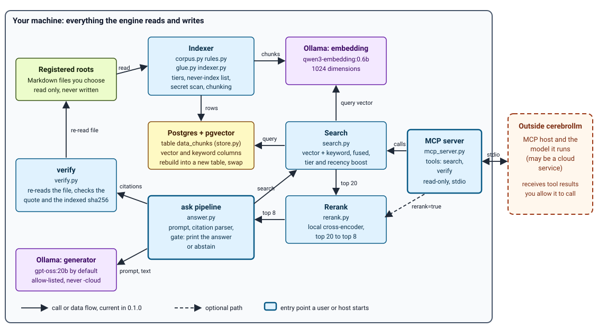
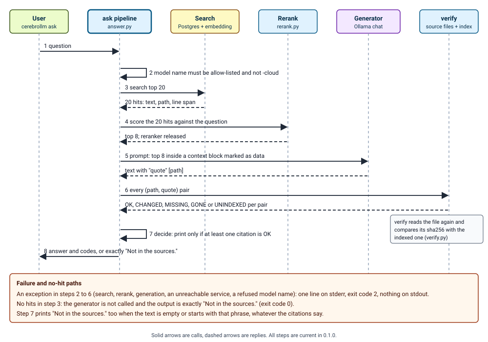

Read section 2 to see how the parts fit and where text leaves the machine, section 5 for the threats and what stops each, and section 6 for the checks that tie each design rule to the evaluation.

# cerebrollm TRD: components, interfaces, trust and checks

## 1. Scope and marks

The PRD fixes what must hold (RQ ids); the LLD fixes files, functions and the 0.2 issues. Section 6 names, for each requirement, its design rule and its check.

Marks: E observed in code or by a check run in this pass; R reported by a committed result file or log; P proposed; N not measured, with the command that would measure it.

## 2. Architecture

cerebrollm has two entry points over one store. `cerebrollm ask` runs the whole pipeline with a local model. `cerebrollm mcp` serves two read-only tools to a host, which may run a cloud model. Indexing is a separate command and the only one that writes the store.

Figure 1. Shows: the components, the entry points (heavy border) and what crosses the machine boundary (the MCP stdio link to a host and its model). Omits: the state folder files, the config files (section 3), the index-time sha256 comparison inside verify, search's own source read for line spans, and the eval harness. Checked against: `cli.py` dispatch; `indexer.run_index` (corpus, glue, `store.embed_model`, `PGVectorStore`, `store.swap_in`); `search.run_search` (store, embed model, RRF); `answer.ask` (search, rerank, `ollama_generate`, `run_verify`); `mcp_server._search_page` and `verify_tool` (search, optional rerank, verify); `verify.run_verify` (`corpus.read_source`, `store.sql`). Inspected: 2026-10-30 by the builder from a headless-browser PNG render; arrows, labels and the boundary box read correctly after one label move; no second reader (reader check: not run).

### 2.1 Components

| Component | Does | Files | Never |
|---|---|---|---|
| CLI | parses arguments, dispatches, sets exit codes | `cli.py`, `__main__.py`, `bin/cerebrollm` | holds logic beyond dispatch |
| Config | loads `cerebrollm.toml`, expands `~` and `$VARS` in path keys, refuses an unset variable | `config.py` | expands variables outside path keys |
| Corpus reader | lists roots, applies never-index rules before any read, reads bytes, dates files | `corpus.py`, `rules.py` | lists a symlink as a file or enters a linked directory; reads a real path outside a directory root (a symlink whose target is inside the root is read) |
| Rules | never-index, tier and status, supersession, duplicate collapse, secret scan | `rules.py` | does I/O |
| Chunker | headings, merge of short sections, one node per table row, sentence split, character spans | `glue.py`, `indexer.chunk_steps` | embeds metadata other than path, title and heading path |
| Indexer | full rebuild into `chunks_next` then swap; `--changed` upsert and delete | `indexer.py`, `store.py` | swaps a table that is empty or under half the live rows |
| Store | Postgres with pgvector over a Unix socket; vector and keyword columns | `store.py` | listens on TCP |
| Search | vector and keyword retrieval fused by reciprocal rank (k = 60), tier and recency boosts, one hit per distinct chunk text | `search.py` | returns `draft` or `superseded` without `--all-status` |
| Reranker | local cross-encoder over the top 20, keeps 8 | `rerank.py` | fetches weights at query time |
| ask pipeline | prompt, generator call, citation parser, gate `decide` | `answer.py` | prints an answer other than the abstention line without an OK citation |
| verify | re-reads the source, compares the normalised quote and the indexed sha256 | `verify.py` | writes anything |
| MCP server | `search` and `verify` over stdio, hit text wrapped as data | `mcp_server.py` | exposes index, status or any write |

### 2.2 Order of calls in `ask`

Figure 2. Shows: the eight steps of one `ask` call, the replies, and the failure and no-hit paths. Omits: the `--no-rerank` branch (the generator then gets the search top 8), the `--think` option, timing, and the JSON output fields. Checked against: `answer.ask` (order of `chat_model`, `search.run_search` with k = 20, `rerank.rerank` with top = 8 then `rerank.release`, `ollama_generate`, `check_citations`, `decide`), `cli.main` (exit 2 on an exception, empty stdout), `answer.decide` (empty text or text starting with the abstention phrase abstains). Inspected: 2026-10-30 by the builder from a headless-browser PNG render; labels moved once to sit above their arrows; no second reader (reader check: not run).

### 2.3 Index build

1. `corpus.enumerate_corpus` walks each root without following links, drops paths by the never-index rules, matches the first tier rule (a file with no rule is not indexed), reads the file, drops it if the secret scan matches, then applies supersession and collapses byte-identical copies.
2. The chunker splits at headings, lets a section under 200 characters absorb the section after it, makes one node per Markdown table row, splits prose at 800 tokens with 60 overlap, and records each chunk's span.
3. The embedding model (Ollama) embeds each chunk with its path, title and heading path; documents carry no query prefix.
4. A full run writes `chunks_next` and swaps it in only if it holds at least half the live rows; otherwise it stops, keeps the new table for inspection and prints the drop command.

## 3. Interfaces

| Command | Effect | Stdout | Exit |
|---|---|---|---|
| `index [--changed]` | build or update the index | JSON summary | 0; 1 with a message on a refused swap or an empty corpus |
| `status [--json]` | counts, skips, last index, model digest | text or JSON | 0 |
| `search QUERY [--k --mode --all-status --project --synonyms --json]` | ranked hits | text or JSON, trimmed toward 2,000 tokens (`search.cap_text`) | 0 |
| `ask QUESTION [--model --think --no-rerank --json]` | pipeline of figure 2 | answer and verify codes, or exactly `Not in the sources.` | 0; 2 on any failure, empty stdout |
| `verify PATH QUOTE [--ref]` | check a quote | `CODE  detail` | 0 only for OK, else 1 |
| `mcp` | serve over stdio | MCP protocol | until the host disconnects |

Global option `--config PATH`; the environment variable `CEREBROLLM_CONFIG` does the same.

| MCP tool | Parameters | Returns |
|---|---|---|
| `search` | `query`, `k`, `mode`, `all_status`, `project`, `page`, `rerank` | a first line saying the text is data; each hit between `<<<BEGIN RETRIEVED DATA>>>` and `<<<END RETRIEVED DATA>>>`; a last line giving the next page; one line with cause and start command when a service is down |
| `verify` | `path`, `quote`, `ref` | one line: code and detail |

| File | Holds |
|---|---|
| `cerebrollm.toml` | domain, state folder, Postgres socket and table, Ollama address and embedding model, chunking, search defaults, tier and recency weights, roots, never-index lists, tier rules |
| `models.toml` | allow-list of Ollama models with role, licence, context cap and digest; the reranker entry with revision, folder, weights sha256 |
| `~/.cerebrollm/` | `state.json`, `docstore.json` (chunk text), `docstore.next.json` during a rebuild, the PostgreSQL cluster, downloaded model folders |

## 4. Data and trust domains

| Domain | Holds | Trust and controls |
|---|---|---|
| D1 corpus files | the user's Markdown | read only; text is data, never instructions; read through `corpus.read_source`, which resolves the real path and refuses one outside a directory root; enumeration skips symlinks |
| D2 index | chunk text, vectors, metadata, file hashes | local Postgres on a Unix socket, trust authentication, folder permissions are the control; derived data, rebuilt from D1 |
| D3 model server | chunk text, queries, prompts, answers | Ollama at the configured address; loopback by default; not restricted by code (K-8) |
| D4 reranker weights | a cross-encoder in a local folder | pinned by revision and sha256 in `models.toml`; not re-hashed at load (K-5) |
| D5 generator output | text with quotes | untrusted until each quote passes `verify` |
| D6 MCP host and its model | tool calls and results | outside cerebrollm; may be a cloud service; the caller is untrusted, the tools are read-only |
| D7 install and download | packages, models, weights | package index, model registry, model host; versions pinned, hashes not required (K-5). The package sets library telemetry and hub downloads off by default (`__init__.py`: `ANONYMIZED_TELEMETRY`, `DO_NOT_TRACK`, `HF_HUB_OFFLINE`, `TRANSFORMERS_OFFLINE`) |

## 5. Threat model

| ID | Threat | What stops it today | Residual |
|---|---|---|---|
| T1 | A document tells the `ask` generator what to say | the prompt marks the context as data between `<<<BEGIN CONTEXT>>>` and `<<<END CONTEXT>>>` (`answer.build_prompt`; test `test_prompt_marks_context_as_data`); the generator has no tools; `decide` needs an OK citation (tests `test_no_citation_abstains`, `test_citation_that_fails_verify_abstains`) | K-1, K-3: wrong text can print beside a true quote |
| T2 | A document tells the MCP host's model what to do | a data line before the hits, markers around each hit, marker strings removed from hit text (`mcp_server._neutral`; test `test_instruction_in_a_hit_stays_inside_its_markers`), exactly two read-only tools (test `test_exactly_search_and_verify`) | the host's other tools are outside this design; K-2 |
| T3 | Private files reach the index or a model | roots are listed by the user; never-index rules run on the path before the read; no catch-all tier rule; symlinks skipped; secret scan skips matching files (`test_rules.py`); containment check on every read (test `test_outside_root_is_refused`); configured excluded paths such as `research/` are skipped before any read (test `test_drafts_folder_is_never_read`; `test_ordinary_drafts_and_notes_are_still_indexed` shows other drafts folders are indexed) | K-2; the exclusion is by path, so a private file inside a registered root that matches a tier rule and holds no secret pattern is indexed |
| T4 | A model's output is trusted without a check | `decide` prints only with a verify-OK citation of at least 8 characters (tests `test_short_quote_and_missing_path_give_no_citation`, `test_unverified_answer_is_replaced`); failures exit 2 (test `test_failure_is_an_error_not_an_answer`) | K-1, K-3 |
| T5 | Option injection through `--ref` or the MCP `ref` | none for git roots (no test) | K-4; the shipped configuration has only a directory root |
| T6 | SQL or query-syntax injection | values are parameters; table names come from the trusted config; tsquery operators are removed from queries (`search.sanitize`) | no test names `sanitize` (gap, LLD I-12); the config file is trusted input |
| T7 | A poisoned package or weights file | pinned versions in `requirements.txt`; weights revision and sha256 and model digests recorded; licence allow-list (`research/model-study/test_model_guard.py`, exists, not re-run) | K-5 |
| T8 | A host's model floods the server | a token budget trims each hit's text toward the budget (`search.cap_text`) | K-6 |
| T9 | Another local user reads the index | the socket sits in the state folder | K-7 |
| T10 | Document text goes to another machine | default address is loopback; `-cloud` model names refused (test `test_refused_model`) | K-8 |

## 6. Requirements and verification plan

| ID | Design rule | PRD | Check | Evidence |
|---|---|---|---|---|
| TQ-01 | Figures 1 and 2 match the code | RQ-04, RQ-07 | each relationship in the figure notes read against the named function | E: done in this pass |
| TQ-02 | Never-index rules run on the path before any read; no rule means not indexed; links skipped; secret scan skips | RQ-09 | `engine/tests/test_rules.py`, `test_corpus.py`, `test_end_to_end.py` | R: passed 2026-10-29 |
| TQ-03 | A full rebuild swaps only a table with at least half the live rows | RQ-11 | `engine/tests/test_swap.py` | R: passed 2026-10-29 |
| TQ-04 | Default search is `locked` and `current` with tier and recency boosts | RQ-10 | `engine/tests/test_search.py` | R: passed 2026-10-29 |
| TQ-05 | The reranker keeps 8 of 20 and is optional | RQ-15 | `engine/tests/test_answer.py`; `eval/runs/retrieval/measure_rerank.py` | R: 45 of 60 without, 46 with (`eval/runs/retrieval/R-summary.md`) |
| TQ-06 | `decide` is the only path to a printed answer | RQ-04, RQ-05 | `engine/tests/test_answer.py` gate and CLI tests; graded arm A4 | R: tests passed 2026-10-29; R: arm A4 graded, 28 of 35 right outcome and 7 of 104 confidently wrong runs for `gpt-oss:20b` (PRD 2.1) |
| TQ-07 | `verify` returns the five codes and reads only inside a root | RQ-06 | `engine/tests/test_verify.py` | R: passed 2026-10-29 |
| TQ-08 | The MCP server exposes exactly two read-only tools and wraps hits as data | RQ-07 | `engine/tests/test_mcp_server.py` | R: passed 2026-10-29 |
| TQ-09 | In the default configuration no code path sends data to a hosted service; a non-loopback Ollama address is not refused until I-04, so this rule fails for such a configuration | RQ-08 | `grep -rnE "https?://" engine/cerebrollm`; network capture under `strace -f -e trace=connect` during `index` and `ask` | E: grep lists one loopback default; E: `__init__.py` sets the opt-out defaults; N: capture not run (LLD I-09) |
| TQ-10 | Only allow-listed Apache-2.0 or MIT models are pulled or called | RQ-14 | `research/model-study/test_model_guard.py`; `engine/tests/test_answer.py` model check | R: model-check tests passed 2026-10-29; N: guard tests not re-run |
| TQ-11 | The evaluation measures arms with and without retrieval and the `ask` pipeline, with a validated grader | RQ-01 to RQ-03, RQ-12 | `python3 eval/run_v2.py report`; grader validation in `eval/RESULTS.md` | R: grader agreed on 39 of 40 answers in its first validation run; R: v2 graded in `eval/RESULTS-v2.md`, with a second grader agreeing on 432 of 454 answers of the `gpt-oss:20b` records |
| TQ-12 | Each threat in section 5 has a named test or a named gap | RQ-18, RQ-19 | the tests named in the T1, T2, T3, T4 and T10 rows exist (R: the engine tests passed 2026-10-29); the T7 test file exists and was not re-run; T5, T6, T8 and T9 have no test and map to K-4, I-12, K-6 and K-7 | E: names read from `engine/tests/` and `research/model-study/`; the map is in section 7 |

## 7. Known limits

| ID | Limit | Evidence | LLD issue |
|---|---|---|---|
| K-1 | When one citation verifies, `ask` prints the generator's whole text; sentences outside the quote are not checked | E: `decide` returns `text` | I-02 |
| K-2 | `verify` tells a quote present in an excluded file (UNINDEXED) from an absent quote (MISSING), so a caller can probe excluded files one guess at a time | E: `run_verify` does not apply the never-index rules | I-01 |
| K-3 | The gate does not check that the cited path was among the retrieved hits or that the quote answers the question | E: `check_citations` calls `run_verify` on the pair only | I-02 |
| K-4 | For a `kind = "git"` root, `verify` builds `git show REF:PATH` from caller input. A scratch test showed `git show --output=x:a.md` read as an option and tried to open a file | E: scratch repository, 2026-10-30, Windows git; the shipped configuration has no git root | I-03 |
| K-5 | Weights and packages are pinned by version or revision, not re-hashed at load or installed with `--require-hashes` | R: reported in the N7 receipt; E: no hash check in `rerank._load` | I-05 |
| K-6 | MCP `k` and `page` have no upper bound, and `cap_text` trims a long hit toward the budget but never below a 200-character allowance and does not cap headers, so output size is trimmed toward the budget and not bounded | E: `search_tool` checks only that they are at least 1; `cap_text` sets `per = max(200, share)`. R: a round 1 reviewer's isolated run with 100 hits printed 26,491 characters against an 8,000-character budget | I-06 |
| K-7 | PostgreSQL uses trust authentication on a socket in the state folder; the folder mode is not checked | E: `engine/setup/user.sh`; N: `stat` of the folder | I-10 |
| K-8 | The Ollama address is not restricted to loopback | E: `config.py` accepts any address | I-04 |

I-09 supplies the capture check of TQ-09, I-11 the report checks of TQ-11, I-07 and I-08 serve the PRD's recall and proof needs, and I-12 adds the missing `sanitize` test.

## 8. Out of scope

A hosted service of any kind; write tools in the MCP server; authentication between host and server (stdio inherits the host's process rights); encryption of the index at rest; a defence against a malicious operating-system user; proof that a quote answers the question.

## 9. Order of work

1. Regenerate the missing `gpt-oss:20b` A4 record (G2-EX-04, run 3) and diagnose the 16 wrong abstentions and 7 confidently wrong passes (PRD 2.1). Check: the PRD key check prints no missing key.
2. Land I-03, I-04 and I-06, one pull request each. Check: the tests named in each LLD acceptance line pass in `cd engine && python -m pytest -q -rs`.
3. Land I-01 after the owner rules on PRD question 7. Check: its new tests in `engine/tests/test_verify.py` pass.
4. Land I-11, I-09, I-10, I-12 and I-05, one pull request each. Check: the acceptance line of each issue in the LLD.
5. Land I-02 after the A4 records show how often unverified text accompanies a verified quote. Check: arm A4 re-run and the report compared with the earlier one. Then land I-07, which widens the citation parser and so follows I-02. Check: its acceptance line in the LLD.

## 10. Owner questions

1. K-2 and K-1 change what `verify` and `ask` return. Accept those changes in 0.2 (PRD questions 6 and 7)? Recommended: yes for K-2, and decide K-1 from the A4 records.
2. Make `allow_remote = false` the default and refuse a non-loopback Ollama address (I-04)? Recommended: yes; a document-text leak by one config line is the worst failure of the local promise.

Skipped or not checked: the full test suite and the model-guard tests were not re-run; no network capture; the index schema was read from code, not from a live database; dependency telemetry; the figures have no second reader.
